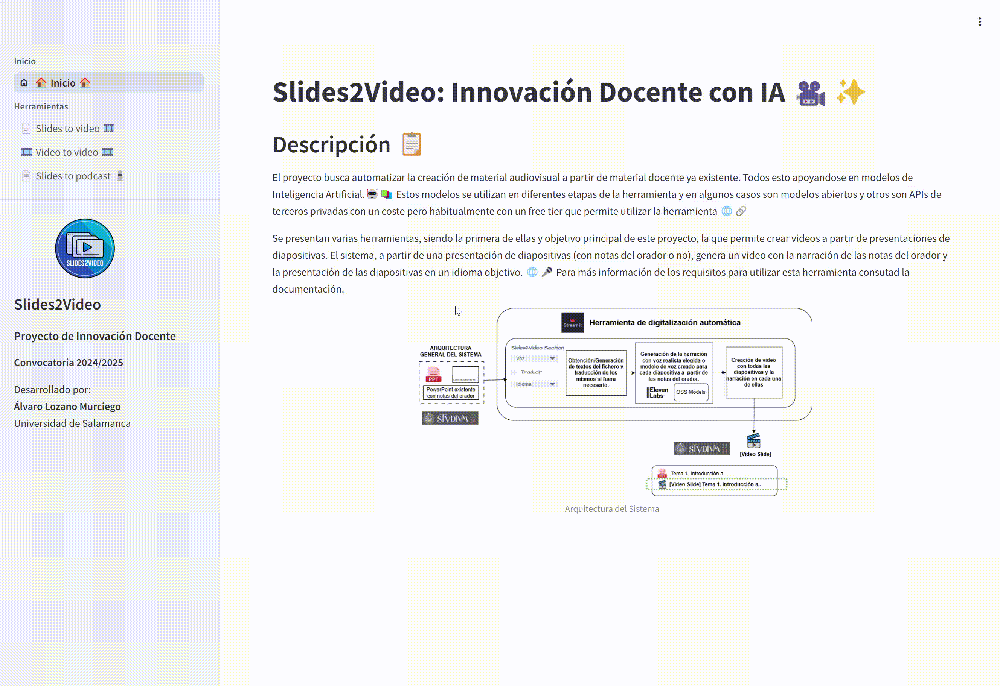

# Slides2Video

This app allows you to convert your slides into a video presentation easily. If your slides are in PDF/PPTX format, you can use this app to generate the narrator notes and create a video with the slides and the audio from that notes.

1. Install the app using the pinokio script.
2. Select the slides2video option in the app.
3. Upload your slides in PDF or PPTX format.
4. generate the narrator notes (or translate them if needed) (using AI).
5. Generate the audio for each slide using TTS (Text to Speech).
6. Generate the video with the slides and the audio.
7. Download the video.

## Check documentation here:

https://slides2video.usal.es